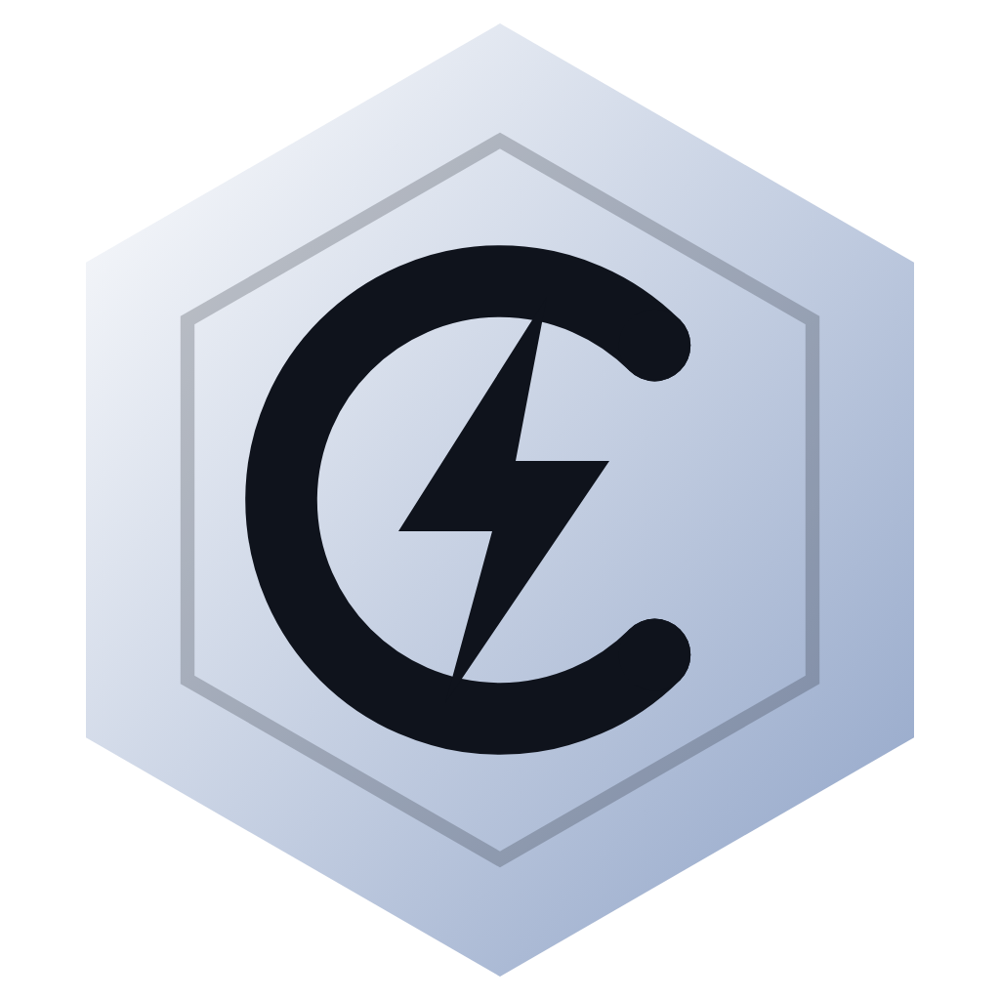

# CeitoTweaks

**La suite definitiva de optimización de Windows y herramientas gamer en un solo clic.**

[Descargar](#-descarga) · [Optimizar](#-optimizar) · [Programas propios](#-programas-optimizados-programas-propios) · [CeitoBrowser](#-ceitobrowser) · [Premium](#-premium) · [FAQ](#-preguntas-frecuentes)

---

## ¿Qué es CeitoTweaks?

**CeitoTweaks** es una aplicación de escritorio para Windows pensada para jugadores y creadores. Junta en una sola interfaz todo lo que normalmente requiere decenas de scripts de dudosa procedencia, programas sueltos o configuraciones manuales:

- **436 tweaks de sistema** en 17 categorías, todos reversibles y con su nivel de riesgo.
- **Optimizar todo en un clic** con perfiles según tu equipo y tu uso.
- **Modo Juego automático** que optimiza la PC al abrir un juego y la deja como estaba al cerrarlo.
- **Casi 50 programas propios** (grabador, clips, navegador, VPN, mira, entrenador de puntería, oficina y mucho más) que se instalan y se usan desde la misma app.
- Diagnósticos en vivo, soluciones en un clic, limpieza, desinstalador con restos y catálogo de apps.

Todo en **7 idiomas**, con recorrido guiado y sin copiar y pegar comandos.

> Este repositorio aloja los instaladores y versiones públicas. El código fuente de la app es privado.

---

## 📥 Descarga

1. Andá a **[Releases](https://github.com/ceitooo/ceitotweaks/releases/latest)**.
2. Descargá el instalador oficial `CeitoTweaks-Setup-X.X.X.exe`.
3. Ejecutalo (pide permisos de administrador para poder tocar registro, servicios y energía).
4. Abrí CeitoTweaks. Las próximas versiones se **actualizan solas**: se bajan en segundo plano, se instalan al cerrar la app (o cuando dejás la PC sin usar) y nunca te interrumpen en medio de un juego.

> **Requisitos:** Windows 10 u 11 de 64 bits y permisos de administrador.
>
> *SmartScreen y antivirus:* como la app no usa un certificado comercial de firma, SmartScreen puede mostrar "editor desconocido" y algunos antivirus pueden marcar como sospechosas partes de la app que usan PowerShell (ver [Preguntas frecuentes](#-preguntas-frecuentes)). Son falsos positivos.

---

## ⚡ Optimizar

### Optimizar todo con un clic
Elegís un perfil y la app aplica el combo de optimizaciones recomendadas para tu caso. Cada perfil se puede **aplicar, desbloquear o revertir** con su propio botón, y antes te ofrece crear un punto de restauración.

- **Competitivo:** máximo FPS y mínima latencia.
- **Streaming:** rendimiento estable para jugar y transmitir a la vez.
- **Notebook:** rendimiento sin destrozar la batería ni la temperatura.
- **Gráficos integrados / APU:** para Ryzen serie G/U e Intel UHD/Iris, con detección automática del equipo.

Nunca aplica tweaks riesgosos por defecto.

### 🛠️ 436 tweaks del sistema
Organizados en **17 categorías**:

| Categoría | Tweaks | Categoría | Tweaks |
|---|---|---|---|
| Red y WiFi | 45 | Priorizar juegos | 20 |
| Segundo plano y telemetría | 45 | Energía | 19 |
| Privacidad | 43 | Periféricos y USB | 19 |
| Windows y sistema | 40 | Almacenamiento | 14 |
| Personalizar Windows | 37 | Optimizar apps (Chrome, Discord, Spotify, Steam…) | 12 |
| Drivers de mouse | 32 | Accesos directos | 10 |
| Optimizar emuladores | 30 | BIOS y drivers | 5 |
| Rendimiento FPS y latencia | 24 | | |
| Gráfica (GPU: NVIDIA, AMD e Intel) | 21 | | |
| CPU y memoria | 20 | | |

Cada tweak tiene su explicación, un botón para activarlo o revertirlo, un indicador de riesgo (**Seguro**, **Precaución** o **Riesgoso**) y una ventana de detalle. Desde Inicio ves cuántos tenés aplicados sobre el total y cuántos te recomendamos.

### 🎮 Modo Juego automático
Al abrir un juego de tu biblioteca (**Steam, Epic Games o Battle.net**), CeitoTweaks:
- le da **prioridad de CPU alta**;
- pone el **plan de energía de alto rendimiento**;
- **silencia las notificaciones** de Windows;
- opcionalmente **suspende o cierra procesos de fondo** (OneDrive, Teams, Widgets, Vínculo móvil…);
- libera RAM **sin tirones**: confirma que la presión de memoria se sostiene, purga primero lo de baja prioridad y protege el juego, el audio y la GPU.

Al cerrar el juego todo vuelve a como estaba y te muestra el tiempo jugado.

### 🌐 Conexiones
- **DNS automático:** cambia el DNS solo cuando el tuyo no contesta o anda lento, y al apagarlo vuelve al que tenías.
- Medidor de ping hacia los servidores de los juegos, test de velocidad y ajustes de red para bajar el ping y los picos.

### 🧰 Más herramientas
- **36 soluciones en un clic:** SFC y DISM, reseteo de red y Winsock, DNS, cola de impresión, Windows Update, tirones y más.
- **Limpieza:** temporales, reportes de error, caché de shaders y restos.
- **Chequeo de PC:** latencia DPC (la causa número uno de los microcortes), drivers y estado del sistema.
- **Debloat:** quitá las apps que vienen de fábrica.
- **Desinstalador inteligente:** desinstala y busca restos en carpetas y en el registro.
- **Apps de inicio:** elegí qué arranca con Windows.
- **Puntos de restauración y backups:** y un botón de "Deshacer todo".
- **Herramientas Pro:** modo MSI de interrupciones, afinidad de núcleos y ajustes avanzados de hardware.
- **Pruebas:** mouse, teclado y mandos (incluida la medición de Hz de sondeo).

---

## 🧩 Programas optimizados (programas propios)

Programas hechos desde cero para CeitoTweaks, livianos y pensados para no robarle rendimiento al juego. Se abren desde el menú **Programas optimizados**, ordenados por categoría.

### 🎮 Juegos
- **CeitoAim:** entrenador 3D de puntería, reflejos y tracking, con estadísticas, armas, mapas y arena 1v1.
- **CeitoCross:** tu propia mira encima de cualquier juego, con códigos de CS2 y Valorant.
- **CeitoType:** test de velocidad de escritura con palabras por minuto y precisión.
- **CeitoX:** usá el mando como teclado y mouse, con perfiles por juego.
- **CeitoPad:** mandos de PlayStation, Xbox y Switch, con giroscopio, touchpad y calibración de drift.
- **CeitoFG:** generación de cuadros para juegos en modo historia.
- **CeitoRes:** armá tu resolución y tus Hz, y probá si tu monitor la aguanta (incluye FSR).
- **CeitoTraductor:** traduce en vivo el texto de una zona de la pantalla mientras jugás.
- **Sensibilidad:** pasá tu sensibilidad de un juego a otro y calibrá tu DPI.
- **Config de juegos:** resolución estirada, configs pro y límite de FPS por juego.
- **Filtro de pantalla:** color y contraste para ver mejor en juegos oscuros, sin delay.
- **Biblioteca:** tus juegos de Steam, Epic y Battle.net en un solo lugar.
- **Desafíos:** misiones diarias y retos de puntería para subir de nivel.

### 🎬 Grabar y crear
- **CeitoClip:** guardá los últimos segundos de juego con un atajo, sin perder FPS. Puede grabar solo una aplicación.
- **CeitoRec:** grabador con escenas: juego, cámara, textos y audio por separado.
- **CeitoShot y CeitoLens:** capturá una zona, marcala, tapá datos o copiá el texto que aparece.
- **CeitoGif:** pasá un video a GIF eligiendo tramo, tamaño, FPS y velocidad.
- **CeitoConvert:** convertí video, audio, imágenes y documentos sin subir nada a internet.
- **CeitoMedia y CeitoLook:** reproductor rápido y vista previa de archivos en el Explorador.
- **CeitoVIA:** mejorá y generá contenido para tus videos e imágenes con IA.
- **CeitoDown:** bajá videos y música de redes sociales en alta calidad.
- **CeitoQR:** códigos QR de links, WiFi, mail o WhatsApp, sin internet.

### 🎧 Audio, teclado y mouse
- **CeitoSound:** cancelación de ruido con IA y ecualizador para escuchar pasos.
- **CeitoBoard:** mostrá en pantalla las teclas que apretás, para streams o práctica.
- **CeitoKeys:** tu teclado suena como uno mecánico mientras escribís.
- **CeitoLyrics:** la letra de la canción que suena, en una ventana encima del juego.
- **Macros:** un atajo que hace varias cosas seguidas: abrir, escribir, silenciar.
- **CeitoClicker:** clics automáticos con el intervalo exacto, con atajo y perfiles.
- **CeitoTask:** grabá lo que hacés con el mouse y el teclado, y repetilo.

### 🌐 Internet y remoto
- **CeitoBrowser:** navegador liviano con bloqueador de anuncios que no frena tus juegos ([ver más](#-ceitobrowser)).
- **CeitoVPN:** VPN gratis: WARP de Cloudflare o un país a elección.
- **CeitoRoute:** DNS más rápido, ruta hasta el servidor del juego y conexión estable.
- **CeitoDesk:** escritorio remoto entre dos PCs: pedí ayuda o manejá otra PC.
- **CeitoScreenshare:** mirá y manejá tu celular Android en la PC, con sonido.

### 🖥️ Escritorio
- **CeitoWall:** fondos animados que se pausan solos cuando jugás.
- **CeitoFlow:** con un atajo abrí apps, hacé cuentas y convertí unidades.
- **CeitoFlyout:** panel desde arriba con volumen, brillo, notas y clima.
- **CeitoPaste:** historial del portapapeles, con imágenes incluidas, a un atajo de distancia.
- **CeitoBreaks:** recordatorios de pausa que no te sacan del juego.
- **CeitoCursor:** cambiá el cursor de Windows: tamaño, estilo y estela.
- **CeitoGameBar:** barra con accesos rápidos que queda siempre arriba y se reserva su espacio.

### 🛡️ Sistema y seguridad
- **CeitoShield:** tu antivirus manejado desde acá, usando Windows Defender.
- **CeitoMonitor:** CPU, GPU, RAM y temperatura en vivo, con gráfico y widget flotante encima del juego.
- **CeitoDiskInfo:** mirá la salud de tus discos, sin instalar nada.
- **CeitoRecover:** buscá archivos borrados y recuperalos en otra unidad.
- **CeitoBloatware:** quitá las apps que vienen de fábrica, con punto de restauración.

### 📄 Oficina
- **CeitoWrite:** documentos con estilos, tablas, imágenes y control de cambios. Abre y guarda Word, ODT y PDF.
- **CeitoSheet:** planillas con fórmulas, gráficos, filtros y tablas dinámicas. Excel y ODS.
- **CeitoSlides:** presentaciones con plantillas y transiciones. Exportá a PowerPoint, PDF o video.

---

## 🌐 CeitoBrowser

Un navegador completo que corre como programa aparte (con su propio acceso directo y la opción de ser tu navegador predeterminado), pensado para no frenar tus juegos.

- **Bloqueador de anuncios y rastreadores** con listas que se actualizan solas, protección contra malware y estafas, y salto de patrocinios en YouTube.
- **Avisos de cookies** rechazados solos ("solo necesarias") y sin trabar el scroll.
- **Protección contra huellas digitales**, "No rastrear", limpieza de links de rastreo y sin AMP.
- **Modo nitidez y fluidez** para videos e imágenes (realce tipo FSR, más cuadros por segundo y desenfoque de movimiento), y **velocidad de video de 0,1x a 4x**.
- **Guardar y compartir:** guardar la página (HTML completo, un solo archivo o PDF), captura de pantalla, instalar una página como app, crear accesos directos, copiar el vínculo y código QR.
- **Perfiles** separados, **cuentas de Google**, **gestor de contraseñas** con importación, **incógnito**, historial, favoritos y descargas.
- **Extensiones de Chrome** y **userscripts**.
- **Barra lateral** con WhatsApp, Gmail, Discord, Telegram, Messenger, Instagram y más.
- Pestañas que duermen para ahorrar RAM, administrador de pestañas, dividir pantalla, modo lectura, versión móvil, traducir página, imagen en imagen y "Descargar con CeitoDown".

---

## 🔗 Integraciones

- **Ceitotify:** Spotify sin publicidad, con instalador y actualización automática del parche.
- **Vencord + StreamEnhance (opcional):** instala Vencord en Discord, lo mantiene actualizado y lo vuelve a parchear si Discord se actualiza.
- **Estado de Discord:** mostrá "Jugando CeitoTweaks" en tu perfil, con tu usuario, la versión y el tiempo jugado (desde Personalizar).
- **Optimizar apps:** saca la aceleración por hardware innecesaria y los procesos de fondo de Discord, Spotify, Chrome, Edge, Brave, Steam y Opera GX.

---

## 📦 Catálogo de apps

- **Más de 180 apps en un clic:** navegadores, launchers, emuladores, streaming, utilidades y diagnóstico.
- **14 programas esenciales preconfigurados:** Timer Resolution, ISLC, FilterKeys Setter, AntimicroX, overclock de mandos y más.
- **Descargas y ofertas:** juegos en descuento y recursos útiles.

---

## 👤 Perfil y comunidad

- **Perfil personalizado:** foto, banner, efectos, insignias, nivel y **música de perfil**.
- **Ranking global (CeitoBench):** medí tu PC y comparate con la comunidad.
- **Community:** perfiles de configuración compartidos por otros usuarios para votar y publicar los tuyos.
- **Mis Settings:** guardá tus configuraciones y llevalas a cualquier PC.
- **Reseñas:** dejá tu opinión desde Inicio.
- **Cambio de PC sin perder Premium:** desvinculá tu hardware anterior con un clic y tu licencia pasa sola a la PC nueva.

---

## 🤖 Asistente y búsqueda

- **Asistente IA:** responde preguntas técnicas teniendo en cuenta tu equipo (incluidas las PCs con gráficos integrados).
- **Buscador rápido (Ctrl+K):** encontrá cualquier tweak, programa o sección al instante.

---

## 🌍 Idiomas y personalización

- **7 idiomas:** español, inglés, portugués, ruso, chino, japonés y coreano.
- **Temas:** Oscuro, Claro, Carmesí, OLED y Medianoche, color de acento libre, tipografías y fondos animados.
- **Barra lateral personalizable:** fijala o dejala desplegable desde Customizar.
- **Voz de bienvenida offline** y **Modo liviano** sin efectos visuales para gastar lo mínimo mientras jugás.

---

## ⭐ Premium

La gran mayoría de CeitoTweaks es **gratis**: más de 360 tweaks, Optimizar todo, el Modo Juego, los programas propios, el instalador de apps, el desinstalador, las soluciones y la limpieza.

**Premium** suma:
- los tweaks de rendimiento extremo (71) y parámetros de lanzamiento avanzados;
- funciones extra en los programas y personalización avanzada del perfil;
- acceso anticipado a novedades.

Hay planes por tiempo y **de por vida (Lifetime)**. Para pagar, la app elige sola el método de tu país (por ejemplo Mercado Pago en Argentina y Uruguay o Yape en Perú) y también tiene métodos internacionales.

---

## ❓ Preguntas frecuentes

**¿Es seguro usar CeitoTweaks?**
Sí. Los tweaks cambian parámetros estándar de Windows (registro, directivas y servicios), todos se pueden revertir y cada uno indica su nivel de riesgo. Antes de aplicar cambios grandes, la app te ofrece crear un punto de restauración.

**Mi antivirus dice que hay un troyano (por ejemplo "HEUR:Trojan.PowerShell…").**
Es un falso positivo de la detección heurística. Algunas funciones (atajos de teclado globales, audio de CeitoClip, filtro de pantalla, medición de mandos) usan PowerShell con funciones de Windows, y eso a veces se confunde con malware. Si te pasa, restaurá los archivos desde la cuarentena y agregá la carpeta de CeitoTweaks (`%LOCALAPPDATA%\Programs\ceitotweaks`) a las exclusiones de tu antivirus.

**No se instalan las actualizaciones automáticas.**
Casi siempre es el antivirus bloqueando el instalador nuevo. Revisá el **Historial de protección** de Seguridad de Windows (o el de tu antivirus), permití lo de CeitoTweaks y agregá la carpeta a las exclusiones. No hace falta apagar SmartScreen ni el "Control inteligente de aplicaciones".

**¿Por qué pide permisos de administrador?**
Cambiar planes de energía, servicios, red y registro requiere permisos elevados en Windows. Sin ellos, el sistema rechaza las optimizaciones.

**¿Funciona en Windows 7 u 8?**
No. CeitoTweaks está hecho y probado para **Windows 10 y 11 de 64 bits**.

**¿Qué pasa con mi Premium si cambio de PC o formateo?**
No perdés nada. Desvinculá la PC anterior con "Reset HWID" y tu licencia se vincula sola a la nueva, con todos tus días.

---

## 🤝 Soporte y comunidad

- 💬 **Discord oficial:** [discord.gg/4Hsfav6wy6](https://discord.gg/4Hsfav6wy6) para soporte, avisos y novedades.
- 🐛 **Reportar un bug:** abrí un [Issue en GitHub](https://github.com/ceitooo/ceitotweaks/issues).

## 📄 Licencia

Este proyecto está bajo la licencia **MIT**. Consultá el archivo [LICENSE](LICENSE).

---

Hecho con Electron. No afiliado comercialmente con Microsoft, NVIDIA, AMD, Intel, Valve, Epic Games, Battle.net, Spotify, Discord ni Cloudflare.

