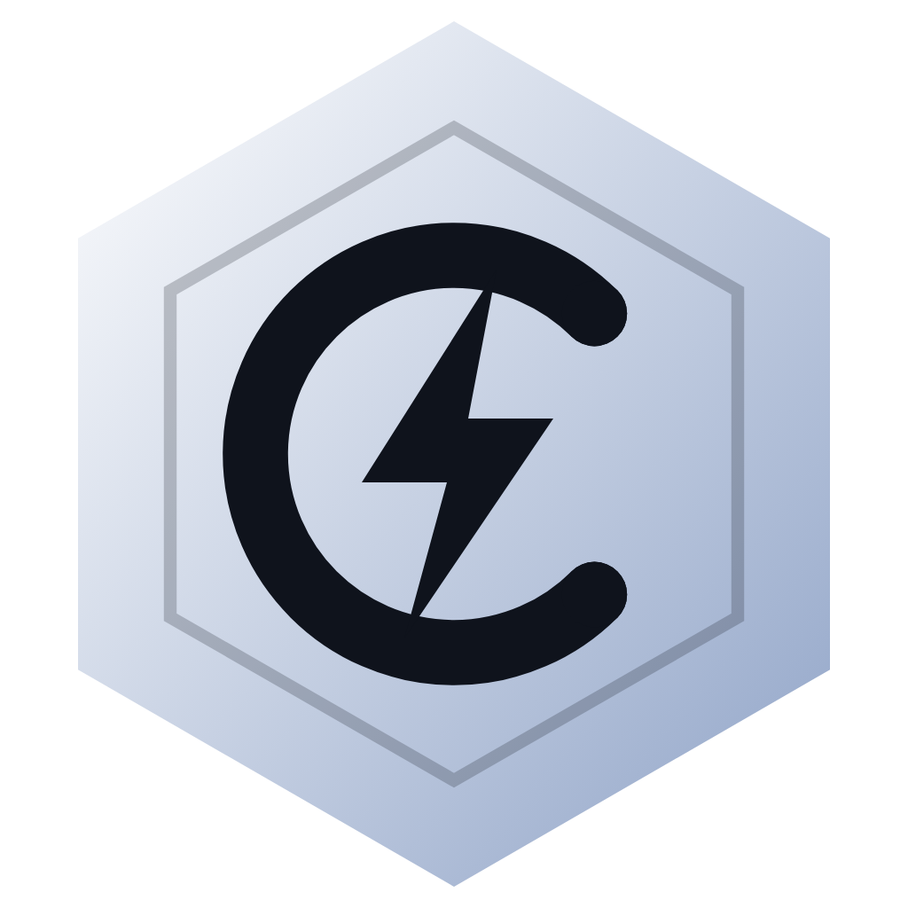

# CeitoTweaks

**La suite definitiva de optimización de Windows y herramientas gamer en un solo clic.**

[Descargar](#-descarga) · [Funciones](#-funciones) · [Suite Gamer](#-suite-gamer-integrada) · [Modo Juego](#-modo-juego-automático) · [Premium](#-premium) · [FAQ](#-preguntas-frecuentes)

---

## ¿Qué es CeitoTweaks?

**CeitoTweaks** es una aplicación integral de escritorio para Windows diseñada para jugadores y creadores. Reúne en una sola interfaz moderna todo lo que normalmente requiere decenas de scripts de procedencia dudosa o configuraciones manuales complejas: **más de 390 tweaks de sistema organizados**, optimización automática de placas de video (NVIDIA y AMD), un **Modo Juego automático**, diagnósticos de hardware en tiempo real, desinstalador inteligente con limpieza de restos, catálogo de apps, suites de práctica y herramientas gamer exclusivas.

Todo con una interfaz intuitiva, en 7 idiomas, con recorrido guiado y sin tener que copiar y pegar comandos de terminal.

> Este repositorio aloja los instaladores y versiones públicas — el código fuente de la app es privado.

---

## 📥 Descarga

1. Andá a la sección **[Releases](https://github.com/ceitooo/ceitotweaks/releases/latest)**.
2. Descargá el instalador oficial `CeitoTweaks-Setup-X.X.X.exe`.
3. Ejecutalo (requiere permisos de administrador para interactuar con registros y servicios del sistema).
4. Abrí CeitoTweaks. Las próximas versiones se actualizan de forma automática — la aplicación te avisa cuando hay una nueva actualización y qué novedades incluye.

> **Requisitos:** Windows 10 u 11 (64 bits), permisos de administrador.
> 
> *Nota sobre Windows SmartScreen:* SmartScreen puede mostrar una advertencia de "editor desconocido" dado que la app no utiliza certificados comerciales EV anuales de alto costo. Esto es habitual en software libre y de desarrolladores independientes. El archivo es 100% seguro.

---

## ✨ Funciones

### ⚡ Optimizar todo con un clic
Elegís el perfil que mejor se adapta a tu uso —**Competitivo**, **Streaming** o **Notebook**— y la aplicación aplica al instante el combo ideal de optimizaciones recomendadas. Nunca aplica ajustes de riesgo por defecto y te ofrece crear un punto de restauración previo.

### 🛠️ Más de 390 tweaks del sistema
Optimizaciones catalogadas rigurosamente en **16 categorías**:
- **Rendimiento FPS & Latencia**
- **Gráfica (GPU)** (NVIDIA, AMD e Intel)
- **Red y WiFi** (reducción de bufferbloat, TCP/IP, optimización DNS)
- **CPU y memoria** (gestión de hilos, afinidad, estacionamiento de núcleos)
- **Planes de energía** (perfiles agresivos, Ceito Notebook Gamer, Ceito Silencioso)
- **Windows & Sistema**
- **Personalización visual**
- **Segundo plano & Telemetría**
- **Privacidad**
- **Almacenamiento**
- **Periféricos & USB**
- **BIOS y drivers**
- **Priorizar juegos**
- **Optimizar Apps** (Chrome, Discord, Spotify, Steam, etc.)
- **Drivers de Mouse** (configuraciones OpenMouse)
- **Accesos directos**

Cada tweak cuenta con su explicación detallada, botón de activación/desactivación reversible e indicador de nivel de riesgo (**Seguro**, **Precaución** o **Riesgoso**).

### 🎮 Modo Juego automático
Configurás tus títulos favoritos una sola vez: al iniciar cualquier juego de tu librería de **Steam, Epic Games o Battle.net**, CeitoTweaks:
- Le asigna **prioridad de CPU alta** en tiempo real.
- Aplica el **plan de energía de alto rendimiento** automáticamente.
- **Silencia las notificaciones** molestas de Windows.
- Opcionalmente **suspende o cierra procesos de fondo** (OneDrive, Teams, Widgets, Phone Link).
- Aplica parámetros de lanzamiento optimizados.

Al cerrar el juego, todos los valores vuelven automáticamente a su estado original y te informa el tiempo jugado.

---

## 🎯 Suite Gamer Integrada

CeitoTweaks no es solo un optimizador: incluye una suite completa de utilidades gamer construidas desde cero:

- **CeitoCross (Mira Overlay):** Mira flotante ultraligera y personalizable sobre cualquier juego. Diseñá tu punto o cruz, ajustá grosor, gap, opacidad, color y exportá/importá códigos de miras de CS2, Valorant o Apex Legends.
- **CeitoAim (Campo de tiro y Arena 1v1):** Entrenador de puntería y calentamiento en 3D integrado directo en la app. Incluye física balística, control de retroceso, selección de armas, cuchillos, skins, mapas y soporte para desafiar amigos en partidas 1v1.
- **CeitoClip:** Capturadora rápida y ligera de jugadas y clips con avisos overlay en pantalla sin consumir recursos de fondo.
- **CeitoVIA:** Asistente gamer inteligente integrado con soporte para comandos rápidos y voz.
- **CeitoBoard & CeitoKeys:** Overlay de pulsación de teclas en pantalla para directos y emulador de sonido en tiempo real con switches mecánicos o sonido de motor.
- **CeitoCursor:** Selector y calibrador de cursores de alta precisión para gaming competitivo.
- **CeitoType:** Mini-juego de entrenamiento de velocidad de mecanografía y memoria muscular con el teclado.
- **Filtro de Pantalla (LUT):** Modos de color y contraste competitivo para mejorar la visibilidad de enemigos o descanso visual nocturno, sin delay ni impacto en la tasa de cuadros por segundo.
- **Calibrador de Mandos / Joysticks:** Medidor en vivo de zonas muertas y herramienta de diagnóstico/calibración de drift para mandos Sony DualSense/DualShock y Xbox.
- **Ceitotify:** Integración directa de Spotify libre de publicidad con instalador y actualizador automático de parches de chunks.
- **CeitoDown:** Centro de descarga de recursos, utilidades esenciales y librerías para gaming.

---

## 📊 Diagnósticos y Monitoreo en Vivo

- **Widget Flotante:** Overlay discreto siempre visible encima de tus juegos con métricas de FPS, uso de CPU, GPU, VRAM, RAM y temperaturas.
- **Detector de Cuello de Botella:** Monitoreo en vivo durante tus partidas para identificar con exactitud qué componente (procesador, placa de video, memoria o disco) está limitando tu tasa de cuadros.
- **Chequeo de Salud del Sistema:** Análisis de latencia DPC (la causa #1 de microstuttering y drops de FPS), estado de drivers y degradación del sistema.
- **Comprobador de Drivers de GPU:** Detección en vivo de nuevas versiones de drivers NVIDIA (conectado al servicio oficial de NVIDIA) y accesos directos para AMD e Intel.
- **Medidor de Ping & Speedtest:** Test de velocidad de red de baja latencia y medidor de ping en vivo hacia los servidores de los principales juegos competitivos por región.
- **Topología USB:** Mapeo de controladoras USB para conectar mouse y teclado en canales independientes y evitar saturación del bus.

---

## 🖥️ Mantenimiento y Soluciones

- **31 Soluciones en un Clic:** Reparación automática de errores frecuentes de Windows (reparación SFC y DISM, reseteo de red y Winsock, purga de DNS, limpieza de cola de impresión, reparación de Windows Update y solución a stuttering).
- **Desinstalador Inteligente:** Desinstalá programas y escaneá residuos en carpetas ocultas y en el Registro de Windows, con análisis de seguridad mediante Windows Defender.
- **Gestor de Inicio:** Controlá exactamente qué aplicaciones se inician con Windows para reducir tiempos de arranque.
- **Limpieza del Sistema:** Liberá espacio borrando temporales, reportes de error, caché de shaders y archivos residuales.
- **Puntos de Restauración & Backups:** Creá puntos de restauración del sistema con un clic y utilizá la función "Deshacer todo" para revertir cambios con total tranquilidad.

---

## 📦 Catálogo de Apps y Herramientas

- **+180 Aplicaciones de un Clic:** Catálogo verificado de navegadores, launchers de juegos, emuladores, software de streaming, utilidades y herramientas de diagnóstico.
- **12 Programas Esenciales Preconfigurados:** Timer Resolution, Optimizer, FilterKeys Setter, AntimicroX, ISLC (Intelligent Standby List Cleaner), overclock de mandos, xCord y más.
- **Optimizar Apps:** Desactivá aceleración por hardware innecesaria y procesos de fondo silenciosos en Discord, Spotify, Google Chrome, Microsoft Edge, Brave, Steam y Opera GX.

---

## ✨ Perfil, Comunidad y Cloud

- **Perfil Personalizado:** Foto, banner, descripción, nivel y registro de logros de optimización.
- **Ranking Global (CeitoBench):** Medí el rendimiento de tu PC y compará tus resultados con la comunidad.
- **Modos Community:** Explorá perfiles de configuración compartidos por otros usuarios, votá y publicá los tuyos.
- **Mis Settings:** Guardá y exportá tus configuraciones favoritas para llevarlas a cualquier PC.
- **Gestión de HWID (Hardware ID):** Si formateás tu computadora o cambiás componentes, podés desvincular tu hardware anterior desde la app con un solo clic; tu cuenta Premium se re-enganchará automáticamente a tu nueva PC sin perder tus días ni tu licencia.

---

## 🌍 Idiomas y Personalización

- **7 Idiomas Soportados:** Español, Inglés, Ruso, Chino, Japonés, Coreano y Portugués.
- **Customización Visual Completa:** Temas Oscuro, Claro, Carmesí, OLED y Medianoche, selector libre de color de acento, tipografías y fondos animados.
- **Voz de Bienvenida Offline:** Voces naturales que saludan al iniciar la app, funcionando 100% de forma local.
- **Modo Liviano:** Opción para desactivar efectos visuales y animaciones de la interfaz, logrando un consumo prácticamente nulo de recursos mientras jugás.

---

## ⭐ Premium

La gran mayoría de CeitoTweaks —más de 300 tweaks, Optimizar todo, el Modo Juego base, la suite de herramientas, el instalador de programas, el desinstalador, las soluciones y la limpieza— es **100% gratuita**.

Para usuarios que buscan exprimir hasta el último FPS, el plan **Premium** desbloquea:
- Tweaks de rendimiento extremo y parámetros de lanzamiento avanzados.
- Funciones pro en la Suite Gamer y personalización estética avanzada del perfil.
- Acceso prioritario a novedades en versión beta.
- Soporte para claves temporales y licencias vitalicias (Lifetime). Métodos de pago flexibles mediante Mercado Pago y Binance Pay.

---

## ❓ Preguntas frecuentes

**¿Es seguro usar CeitoTweaks?**
Sí. Todos los tweaks aplican modificaciones reversibles sobre parámetros estándar de Windows (Registro, directivas y servicios). Cada tweak cuenta con una clasificación clara (**Seguro**, **Precaución**, **Riesgoso**) y la app te permite crear un punto de restauración antes de aplicar cambios.

**¿Por qué solicita permisos de administrador?**
Modificar planes de energía, servicios del sistema, directivas de red y claves de registro requiere privilegios elevados en Windows. Sin estos permisos, el sistema operativo rechaza las optimizaciones.

**¿Funciona en Windows 7 u 8?**
No. CeitoTweaks está desarrollado y testeado específicamente para **Windows 10 y Windows 11 (64 bits)**.

**¿Qué pasa con mi Premium si cambio de PC o formateo Windows?**
No perdés nada. Podés desvincular tu PC anterior con el botón de "Reset HWID" y la próxima vez que apliques un tweak o inicies sesión, tu licencia se vinculará de forma automática a tu nuevo hardware conservando todos tus días restantes.

---

## 🤝 Soporte y Comunidad

¿Encontraste un problema o querés sugerir una nueva función?
- 💬 **Discord Oficial:** Unite a nuestra comunidad en [discord.gg/4Hsfav6wy6](https://discord.gg/4Hsfav6wy6) para soporte directo, avisos y novedades.
- 🐛 **Reportar un bug:** Abrí un [Issue en GitHub](https://github.com/ceitooo/ceitotweaks/issues).

## 📄 Licencia

Este proyecto está bajo la Licencia **MIT** — consultá el archivo [LICENSE](LICENSE) para más detalles.

---

Hecho con Electron. No afiliado comercialmente con Microsoft, NVIDIA, AMD, Intel, Steam, Epic Games ni Battle.net.

